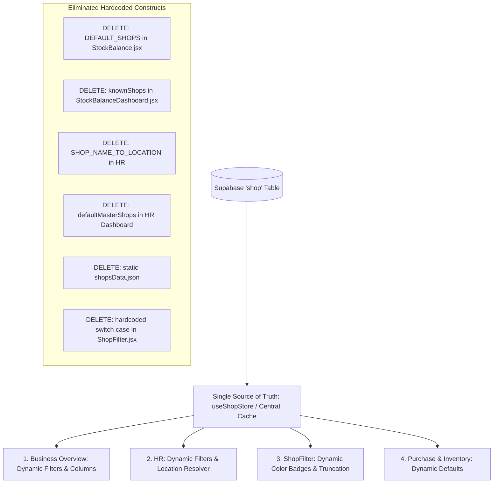
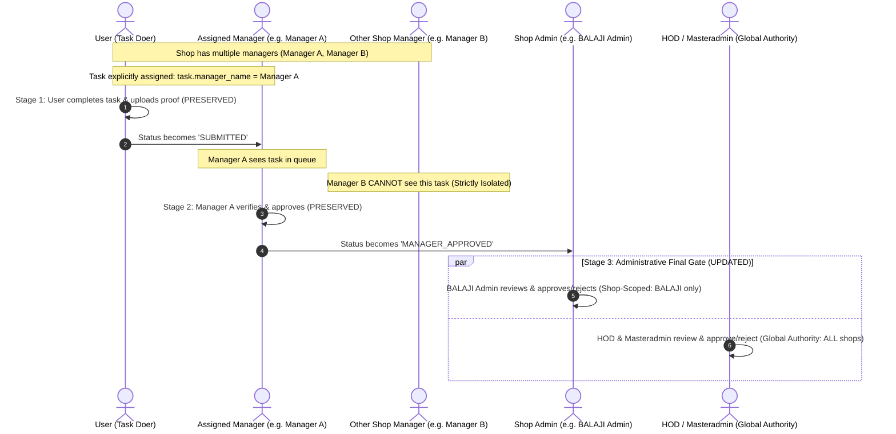

# Drinqkart RBAC & Database-Driven Architecture Specification

> **Status:** Final Approved Specification  
> **Date:** October 2026  
> **Target Scope:** Master Settings, Checklist & Delegation System, Database-Driven Shop Master, and All Core Sub-Systems (`purchase`, `inventory`, `hr`, `checklist`, `petty-cash`, `business-overview`, `sales-analytics`)

---

## 1. Executive Summary & Objective

The objective of this specification is to define and enforce a comprehensive **Role-Based Access Control (RBAC)** architecture and a **Universal Database-Driven Master Architecture** across the entire Drinqkart Enterprise Console.

### Core Architecture Pillars:
1. **Organizational Hierarchy**:
   $$\mathbf{User \ (L1) < Manager \ (L2) < Admin \ (L3) < HOD \ (L4) < Masteradmin \ (L5)}$$
2. **Masteradmin (Level 5 — Apex Superadmin)**:
   - Dedicated, exclusive apex role held strictly by **Employee ID 999** (`username: "masteradmin"`).
   - Holds supreme, absolute authority over the entire enterprise above HOD.
   - **Singleton Constraint**: Exactly **one (1)** Masteradmin account can exist. The `Masteradmin` role option is **permanently hidden** from Master Setting role selectors.
   - Cannot be deleted, demoted, or deactivated.
3. **Authority & Data Scoping**:
   - **HOD (Level 4)**: Global scope across all shops; unrestricted view, create, modify, edit, delete, and supreme final approval authority across all branches.
   - **Admin (Level 3)**: Shop-scoped authority strictly restricted to assigned shop(s); view, create, modify, edit, delete, and approve only within assigned shop(s). Cannot manage Admin, HOD, or Masteradmin roles.
4. **Universal Database-Driven Shop Master**:
   - The Supabase `shop` table is the **single source of truth** for all shops and their locations.
   - **All hardcoded shop arrays, fallbacks, and location dictionaries across all systems are permanently removed**.
5. **Permission Granularity**:
   - Explicit enforcement of `none`, `view`, and `modify` across all pages. Resolves the systemic flaw where `view` permission grants write/CRUD capabilities.
6. **Checklist & Delegation Approvals**:
   - Multi-manager store support and 1-to-1 task-level manager assignment are **strictly preserved and protected**.
   - The Stage 3 Administrative Gate is updated so **Admin** can only approve their assigned shop's tasks, while **HOD & Masteradmin** hold supreme global approval authority across all shops.

---

## 2. Invariant Constraints: What MUST NOT Be Touched

> [!IMPORTANT]
> **Zero-Impact Guarantee for User & Manager Levels:**  
> Under no circumstances will any existing operational code paths, state logic, form handlers, submission flows, or approval routing for the `User` and `Manager` levels be modified or disrupted.
>
> 1. **User Role (Doer Level)**:
>    - Task view, submission flow, proof photo upload, voice note recording, and remark inputs remain **100% untouched**.
> 2. **Manager Role (Supervisory Level)**:
>    - Multi-manager store support remains **100% untouched** (a single shop can have multiple managers).
>    - 1-to-1 task-to-manager routing (`task.manager_name = current_manager.username`) remains **100% untouched**.
>    - Other managers in the same shop continue to be isolated from tasks not assigned to them.
>    - Manager verification and status transition to `MANAGER_APPROVED` remains **100% untouched**.

---

## 3. Role Hierarchy & Authority Matrix

```
┌────────────────────────────────────────────────────────┐
│  Masteradmin (Emp 999 Only) - Level 5 (Apex)           │
│  • Exactly 1 Account in Entire Enterprise              │
│  • Absolute authority over all roles, shops & systems  │
│  • Role option hidden from UI (cannot create more)     │
│  • Completely immune from deletion or demotion         │
└──────────────────────────┬─────────────────────────────┘
                           │
┌──────────────────────────▼─────────────────────────────┐
│  HOD (Head of Department / Superadmin) - Level 4       │
│  • Global Scope (All Shops)                            │
│  • Full CRUD: View, Create, Modify, Edit, Delete       │
│  • Supreme Final Approval across all enterprise shops  │
│  • Can manage Admins, Managers, and Users              │
│  • Can configure global Master Settings                │
└──────────────────────────┬─────────────────────────────┘
                           │
┌──────────────────────────▼─────────────────────────────┐
│  Admin (Store / Regional Admin) - Level 3              │
│  • Shop-Scoped (Assigned Shop[s] Only)                 │
│  • CRUD restricted strictly to assigned shop records   │
│  • Final Approvals restricted to assigned shop(s)      │
│  • Can only create/edit/delete Users & Managers        │
│  • Cannot manage Admins, HODs, or Masteradmin          │
└──────────────────────────┬─────────────────────────────┘
                           │
┌──────────────────────────▼─────────────────────────────┐
│  Manager (Store / Dept Supervisor) - Level 2           │
│  • Shop-Scoped (Assigned Shop Only)                    │
│  • Multiple Managers per store supported               │
│  • 1-to-1 task supervision for assigned tasks          │
│  • No access to Master Settings / User management      │
└──────────────────────────┬─────────────────────────────┘
                           │
┌──────────────────────────▼─────────────────────────────┐
│  User (Operator / Cashier / Staff) - Level 1           │
│  • Shop & Counter-Scoped                               │
│  • Base level: view or submit specific assigned tasks  │
└────────────────────────────────────────────────────────┘
```

| Role | Hierarchy Level | Data Scope Boundary | User Management Capability | Operational Actions (Forms, Approvals, CRUD) | Global Master Settings Access |
| :--- | :--- | :--- | :--- | :--- | :--- |
| **Masteradmin** | **Level 5** *(Apex)* | **Absolute Global (All Shops)** | Full View, Create, Edit, and Delete across all users, managers, admins, and HODs. Can never be deleted or edited by anyone else. | Absolute supreme authority over all operations, approvals, and logs across the entire platform. | Full unrestricted access over all shops, counters, expenses, and access rights. |
| **HOD** | **Level 4** | **Global (All Shops)** | Full View, Create, Edit, and **Delete** across Admins, Managers, and Users. Cannot delete or demote Masteradmin. | Full View, Create, Edit, Approve, and Delete across **all stores**. Supreme final approval on all tasks. | Full View, Add, Edit, and Delete across Shops, Counters, Expenses, and System Access. |
| **Admin** | **Level 3** | **Assigned Shop(s) Only** | View, Create, Edit, and **Delete** users **strictly belonging to their assigned shop(s)**. Can only manage `User` and `Manager` accounts. | Full View, Create, Edit, and Delete operational records **only within assigned shop(s)**. Final approval **only for assigned shop(s)**. | View only; cannot alter global shops, global counters, or other stores' settings. |
| **Manager** | **Level 2** | **Assigned Shop Only** | None (cannot access user administration). | Daily operational approvals, supervisor checks, cash verification for tasks assigned to them within assigned shop. | None (hidden / blocked). |
| **User** | **Level 1** *(Base)* | **Assigned Shop / Counter** | None. | Operational actions strictly dictated by page permission (`none`, `view`, or `modify`). | None (hidden / blocked). |

---

## 4. Masteradmin Rules & Master Settings Constraints

### 4.1 The Singleton Account Rule
1. **Single Account Law**:
   - There can **never** be more than one Masteradmin account in the database.
   - That account belongs permanently to **Employee ID 999** (username: `masteradmin`).
2. **Hidden from Role Dropdown**:
   - In [MasterSetting.jsx](file:///c:/Users/prata/Downloads/drinqkart/src/pages/MasterSetting.jsx):
     - **"Add User" Modal**: The `<select>` for role contains: `User`, `Manager`, `HOD`, `Admin`. The option `Masteradmin` is **strictly hidden**.
     - **"Edit User" Modal**:
       - When editing any other user: `Masteradmin` does **NOT** appear in the role selector.
       - When viewing Employee 999: The role displays `Masteradmin` as a disabled badge/locked input so nobody can accidentally demote it.
3. **Permanent Deletion Immunity**:
   - Employee ID 999 (Masteradmin) **cannot be deleted**.
   - The Delete button is permanently hidden for the Masteradmin row in the users table, even when viewed by an HOD or Masteradmin themselves.

---

## 5. Universal Database-Driven Shop Master (Eliminating Hardcoded Data)

The global Supabase `shop` table is the **single source of truth** across all systems.

### 5.1 Authoritative Schema (`shop` Table)
```
Table: "shop"
├── id: bigint (Primary Key)
├── shop_name: text (e.g. BALAJI, FRIENDS, KUNAL KHARGHAR, KUNAL ULWE, MADHURA, OFFICE, TLS)
├── full_name: text (e.g. Friends Wines Merchants, Kunal Fine Wine)
├── location: text (e.g. AKOLE, WAGHOLI, KHARGHAR, ULWE, BAVDHAN, HINJEWADI)
├── gstin: text
├── contact: text
├── email: text
├── badge_color: text (Optional, e.g. 'blue', 'emerald', 'amber', 'purple', 'rose')
└── created_at: timestamp
```

### 5.2 Hardcoded Data Elimination Plan



| System | File | Hardcoded Construct to DELETE | Database-Driven Replacement |
| :--- | :--- | :--- | :--- |
| **Sales Analytics** | [StockBalance.jsx](file:///c:/Users/prata/Downloads/drinqkart/src/systems/business-overview/pages/StockBalance.jsx) | `const DEFAULT_SHOPS = ['BALAJI', 'FRIENDS', ...]` | Fetch dynamic shop names from `shop` table via `useShopStore`. |
| **Sales Analytics** | [StockBalanceDashboard.jsx](file:///c:/Users/prata/Downloads/drinqkart/src/systems/business-overview/pages/StockBalanceDashboard.jsx) | `const knownShops = ["BALAJI", "FRIENDS", ...]` | Fetch dynamic shop names from `shop` table via `useShopStore`. |
| **Sales Analytics** | [GroupWiseStoreWiseSale.jsx](file:///c:/Users/prata/Downloads/drinqkart/src/systems/business-overview/components/GroupWiseStoreWiseSale.jsx) | Fallback array `["BALAJI", "FRIENDS", "KUNAL KHARGHAR", "TLS"]` | Dynamic store columns from active `shop` records. |
| **Sales Analytics** | [BrandWiseSale.jsx](file:///c:/Users/prata/Downloads/drinqkart/src/systems/business-overview/components/BrandWiseSale.jsx) | Fallback array `["BALAJI", "FRIENDS", "KUNAL KHARGHAR", "TLS"]` | Dynamic store columns from active `shop` records. |
| **HR System** | [AttendanceDaily.jsx](file:///c:/Users/prata/Downloads/drinqkart/src/systems/hr/pages/AttendanceDaily.jsx) | `SHOP_NAME_TO_LOCATION` dictionary & `DEVICES` shop names | Read location directly from `shop.location`. Dynamic shop dropdowns. |
| **HR System** | [Employees.jsx](file:///c:/Users/prata/Downloads/drinqkart/src/systems/hr/pages/Employees.jsx) | `SHOP_NAME_TO_LOCATION` dictionary | Read location directly from `shop.location`. |
| **HR System** | [JoiningCompany.jsx](file:///c:/Users/prata/Downloads/drinqkart/src/systems/hr/pages/JoiningCompany.jsx) | `SHOP_NAME_TO_LOCATION` dictionary | Read location directly from `shop.location`. |
| **HR System** | [Dashboard.jsx (HR)](file:///c:/Users/prata/Downloads/drinqkart/src/systems/hr/pages/Dashboard.jsx) | `const defaultMasterShops = [...]` | Fetch shops dynamically from `shop` table. |
| **Global Layout** | [ShopFilter.jsx](file:///c:/Users/prata/Downloads/drinqkart/src/layout/ShopFilter.jsx) | Hardcoded `switch(shop) { case "FRIENDS": ... }` | Dynamic badge styling using database `badge_color` + deterministic hash fallback. |
| **Static Data** | [shopsData.json](file:///c:/Users/prata/Downloads/drinqkart/src/data/shopsData.json) | 183 lines of static mock stores | Completely removed or decoupled. |
| **Purchase** | [poHelpers.js](file:///c:/Users/prata/Downloads/drinqkart/src/systems/purchase/utils/poHelpers.js) | `if (shopName.includes("kunal") || shopName === "balaji")` | Dynamic company setting flag from `shop` / company settings. |

### 5.3 Dynamic Shop Badge Styling & Elimination of Switch Statements ([ShopFilter.jsx](file:///c:/Users/prata/Downloads/drinqkart/src/layout/ShopFilter.jsx))

To permanently replace the hardcoded `switch(shop)` statements:

1. **Database Theme Color (Primary)**:
   - Read `shop.badge_color` from the `shop` table if configured by Masteradmin in Master Settings (e.g. `'blue'`, `'emerald'`, `'amber'`, `'purple'`, `'rose'`).
2. **Deterministic Color Hashing (Automatic Universal Fallback)**:
   - For shops without an explicit theme, compute a stable, repeatable color palette using a fast string-hash algorithm:
     $$\text{Index} = |\text{hash}(\text{shop\_name})| \pmod{\text{length of PALETTES}}$$
   - Any new shop added automatically receives a distinct, consistent color badge without touching code.
3. **Dynamic Name Truncation**:
   - Replace the hardcoded `if (shop === "The Liquor Story - Vishal - Hinjewadi")` with dynamic character capping:
     ```javascript
     const getShopLabel = (shop) => {
       if (!shop) return "";
       return shop.length > 22 ? `${shop.slice(0, 19)}...` : shop;
     };
     ```

---

## 6. Checklist & Delegation Approval Lifecycle

The Checklist & Delegation system operates as a 3-stage lifecycle:



### Stage Breakdown:
1. **Stage 1 — User Execution (Preserved)**:
   - User completes task, uploads photos/voice notes, and submits.
   - Status: `SUBMITTED`.
2. **Stage 2 — Assigned Manager Approval (Preserved)**:
   - Only the specifically assigned manager (`task.manager_name === current_manager.username`) can see and approve the task.
   - Other managers in the same shop cannot see or act on it.
   - Upon approval, status transitions to `MANAGER_APPROVED`.
3. **Stage 3 — Final Administrative Approval (Targeted Update)**:
   - **Admin**: Only sees `MANAGER_APPROVED` tasks where `task.shop` (or `task.shop_name`) matches their `assigned_shops`. Admins from other shops cannot see or approve them.
   - **HOD & Masteradmin**: Hold supreme global authority across **all shops**. Can view, approve, reject, or remark on `MANAGER_APPROVED` requests from any store in the company.

---

## 7. The 3-Tier Permission States per Page / Module

Every module and page across all systems is governed by one of three explicit permission states:

| Permission State | Navigation Visibility | Page Access | UI Actions & Controls | Form Behavior |
| :--- | :--- | :--- | :--- | :--- |
| **`none`** | **Hidden** from sidebar & navigation | Blocked / Redirected to unauthorized page | None | None |
| **`view`** | **Visible** in sidebar & navigation | Accessible | • "Add New", "Create", "Edit", "Delete", "Submit", "Approve" buttons are **hidden or disabled**.<br>• Export and search/filter tools remain active. | Read-only mode with a clear visual banner (`View-Only Mode`). Form submissions blocked. |
| **`modify`** | **Visible** in sidebar & navigation | Accessible | Full Create, Read, Update, and Delete actions enabled, **bounded by the user's role hierarchy and assigned shop scope**. | Full input and submission capabilities. |

---

## 8. Current Defects & Root Cause Analysis

Investigation confirmed 5 architectural flaws causing `view` permissions to grant write/CRUD capabilities system-wide:

1. **Binary Boolean Flattening in Purchase (`src/systems/purchase/store/useAuthStore.js`)**:
   - Maps both `.modify` and `.view` to the identical permission key (`'indent'`).
   - Components only check `hasPermission('indent')` and unlock all create/approve/submit buttons.
2. **View/Modify OR Conjunction in Inventory (`src/systems/inventory`)**:
   - `hasMasterPerm` returns `true` if *either* `.view` or `.modify` exists.
   - `FormEntry.jsx` unlocks quantity selection and database submission for view-only users.
3. **Missing `readOnly` Implementation in HR (`src/systems/hr/pages/JoiningCompany.jsx`)**:
   - Declares `readOnly = false` in props, but never references it in any of its 977 lines.
   - All "Add Shop", "Edit Shop", and "Upload QR" buttons remain active.
4. **Blanket Role Overrides in Master Settings & Layout**:
   - Code snippets like `if (role === 'admin') return 'modify'` override granular `view` settings.
5. **Absence of Mutation Guards in Checklist & Petty Cash**:
   - `checklist` splits keys by dot and grants full page access without differentiating view vs modify.
   - `petty-cash` checks page access on button handlers rather than checking `hasPageModifyAccess`.

---

## 9. Phased Implementation Roadmap

### Phase 1: Shared Permission Engine (`src/utils/permissionUtils.js`)
Create a single, authoritative permission evaluator shared across all systems:
```javascript
export function getSystemPagePermission(currentUser, systemId, pageName) {
  // 1. Masteradmin (Emp 999) / HOD check (Global Unrestricted)
  // 2. Parse master_user_system_page_access
  // 3. Extract level: 'none' | 'view' | 'modify'
  // 4. Resolve Shop Scope (Admin -> assigned_shops only; HOD/Masteradmin -> all shops)
  // 5. Return standardized capability object
}
```

### Phase 2: Refactor [MasterSetting.jsx](file:///c:/Users/prata/Downloads/drinqkart/src/pages/MasterSetting.jsx)
1. **Masteradmin Role Setup**:
   - Set Employee 999's role to `masteradmin`.
   - Hide `Masteradmin` option from Add User and Edit User role selectors.
   - Prevent deletion or demotion of Employee 999.
2. **Remove blanket `role === 'admin'` overrides**.
3. **Filter users table for Admins** by their assigned shops.
4. **Cap "Add User" role dropdown** to `User` and `Manager` for Admins.
5. **Restrict Admin edit/delete buttons** to Users and Managers within their assigned shop. HOD and Masteradmin maintain global management.

### Phase 3: Universal Database-Driven Shop Master Migration
1. **Centralize Shop Fetching**: Ensure `useShopStore.js` is the standard cache across all sub-apps.
2. **Business Overview & Sales Analytics**:
   - Delete `DEFAULT_SHOPS`, `knownShops`, and static chart fallback arrays.
   - Wire all sidebar filters and chart columns directly to `shop` table records.
3. **HR & Attendance**:
   - Delete `SHOP_NAME_TO_LOCATION` maps; read `s.location` directly from the `shop` table records.
   - Populate employee joining company and attendance store dropdowns dynamically.
4. **Layout**: Update `ShopFilter.jsx` to dynamically render badges for any store in the `shop` table without hardcoded switch statements.

### Phase 4: Refactor Checklist Admin Approval Page ([AdminApprovalPage.jsx](file:///c:/Users/prata/Downloads/drinqkart/src/systems/checklist/pages/admin/AdminApprovalPage.jsx))
1. **Preserve User $\rightarrow$ Manager Pipeline**: Keep `task.manager_name` matching and `taskStatus === 'manager_approved'` requirements untouched.
2. **Admin Final Approval Scoping**:
   - Filter `MANAGER_APPROVED` tasks so Admins only see and act on tasks from their `assigned_shops`.
3. **HOD & Masteradmin Global Supreme Authority**:
   - Remove legacy `reported_by` restriction for HOD and Masteradmin.
   - Grant full visibility to approve or reject `MANAGER_APPROVED` requests across all shops.

### Phase 5: System-by-System UI & Form Enforcement
* **Purchase**: Refactor `useAuthStore.js` to expose distinct `canView` and `canModify`. Hide "Create", "Approve", and "Submit" buttons when view-only.
* **Inventory**: In `FormEntry.jsx`, disable form inputs and hide "Submit Form" for view-only users.
* **HR**: In `JoiningCompany.jsx`, wire `readOnly` to hide "Add Shop", "Edit Shop", and "Upload QR". Guard child pages in `src/systems/hr/App.jsx`.
* **Checklist**: In `QuickTaskPage`, `AssignTaskPage`, and `HolidayListPage`, hide task creation and deletion buttons for view-only users.
* **Petty Cash**: Ensure `hasPageModifyAccess` guards all save/submit handlers across `PettyCashForm`, `CashTallyPage`, and `BankAudit`.

---

## 10. Verification & Test Scenarios

| Test Case | Role | Scenario / Action | Expected Outcome |
| :--- | :--- | :--- | :--- |
| **TC-01** | User | `purchase.Indent.view` | Can browse indents; **cannot** create or submit an indent. "Create Indent" button hidden. |
| **TC-02** | User | `purchase.Indent.modify` | Can browse, create, and submit indents for assigned shop. |
| **TC-03** | User | `purchase.Indent` = `none` | Indent tab hidden; direct URL `/systems/purchase/indent` redirects. |
| **TC-04** | Admin (Shop: BALAJI) | `master-setting.User & System Access.modify` | Sees only BALAJI users in Master Settings. Can edit/delete Users/Managers in BALAJI. Cannot edit Admins, HODs, or Masteradmin. Cannot see FRIENDS or KUNAL users. |
| **TC-05** | Admin (Shop: BALAJI) | Click "Add User" | Shop is locked to BALAJI; Role selector only permits `User` or `Manager`. `Masteradmin` option does NOT appear. |
| **TC-06** | User $\rightarrow$ Manager $\rightarrow$ Admin | Task Completion in BALAJI | User completes task $\rightarrow$ assigned Manager A approves $\rightarrow$ moves to `MANAGER_APPROVED`. BALAJI Admin sees & approves it. FRIENDS Admin cannot see it. |
| **TC-07** | HOD / Masteradmin | Final Task Approvals | HOD and Masteradmin see and can approve/reject `MANAGER_APPROVED` tasks from BALAJI, FRIENDS, KUNAL, and all other shops. |
| **TC-08** | Any User | Open Edit User on any account | Option `Masteradmin` is completely hidden from the Role dropdown. |
| **TC-09** | Any Role | View Employee 999 in Users table | Delete button is permanently hidden; role is locked to `Masteradmin`. |
| **TC-10** | Masteradmin | Add 8th shop in Master Settings (`shop` table) | The new shop instantly appears in Global Shop Filter, Sales Analytics sidebar, and HR dropdowns with **zero code changes**. |
| **TC-11** | Admin | `inventory.Purchase Form Entry.view` | Can view logs and history; form submit button is disabled/hidden. |
| **TC-12** | User | `hr.Joining shop.view` | Can view shop list, locations, and GSTIN; "Add Shop", "Edit Shop", and "Upload QR" buttons are hidden. |

---

## 11. Approval & Sign-Off

- [x] Hierarchy approved: `User < Manager < Admin < HOD < Masteradmin`
- [x] Masteradmin singleton constraint approved (Emp ID 999 only, hidden from role dropdowns, undeletable)
- [x] Scope rules approved: HOD & Masteradmin = Global, Admin = Assigned Shop(s) Only
- [x] Universal database-driven shop master approved (delete all hardcoded shops across systems)
- [x] Multi-manager shop support preserved (task-level 1-to-1 manager assignment intact)
- [x] Invariant constraints locked (User and Manager levels guaranteed zero impact)
- [x] Stage 3 Approval Gate updated (Admin = shop-scoped, HOD/Masteradmin = global supreme authority)
- [x] View-only enforcement plan approved across all 6 systems
- [x] Ready for phased execution
