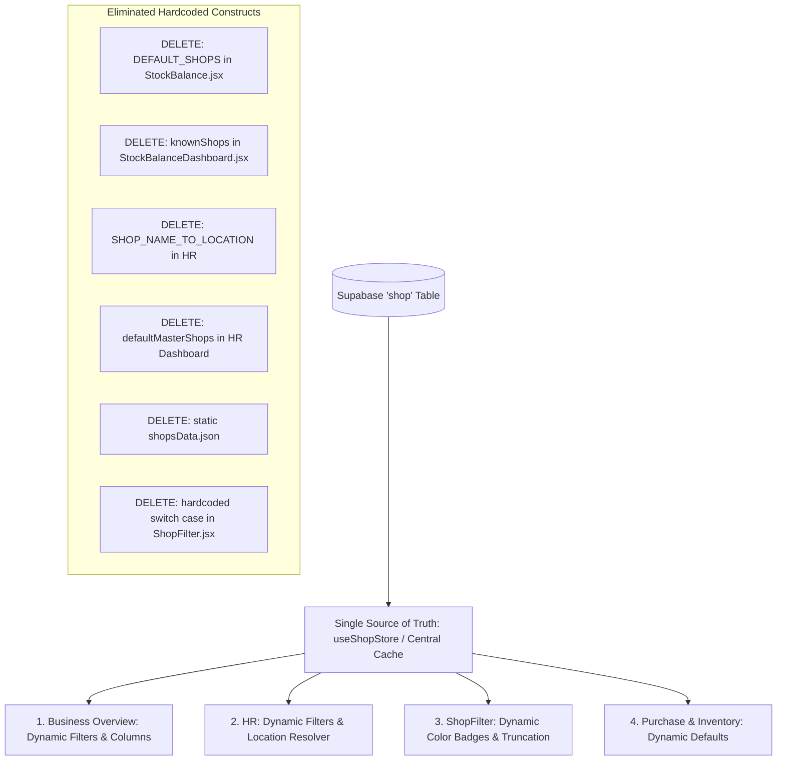
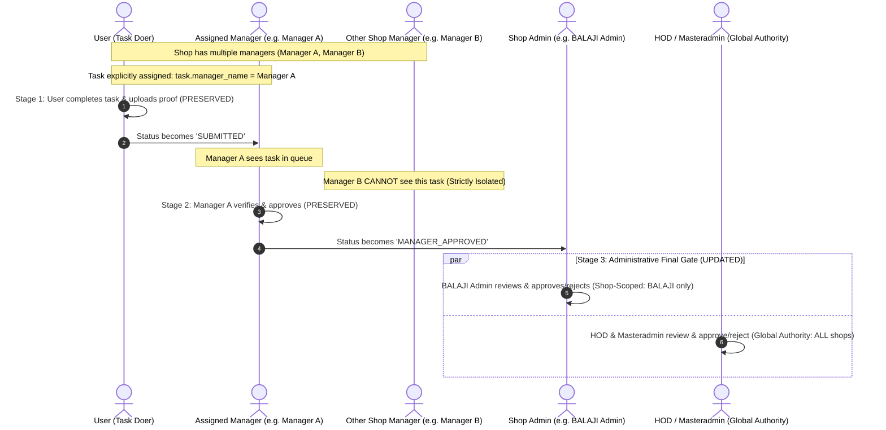

# Drinqkart RBAC & Database-Driven Architecture Specification

> **Status:** Final Approved Specification  
> **Date:** October 2026  
> **Target Scope:** Master Settings, Checklist & Delegation System, Database-Driven Shop Master, and All Core Sub-Systems (`purchase`, `inventory`, `hr`, `checklist`, `petty-cash`, `business-overview`, `sales-analytics`)

---

## 1. Executive Summary & Objective

The objective of this specification is to define and enforce a comprehensive **Role-Based Access Control (RBAC)** architecture and a **Universal Database-Driven Master Architecture** across the entire Drinqkart Enterprise Console.

### Core Architecture Pillars:
1. **Organizational Hierarchy**:
   $$\mathbf{User \ (L1) < Manager \ (L2) < Admin \ (L3) < HOD \ (L4) < Superadmin \ (L5)}$$
2. **Superadmin (Level 5 — Apex Superadmin)**:
   - Holds supreme, apex authority over the entire enterprise above HOD.
   - **Dynamic Singleton Constraint (Zero Hardcoded Employee Codes)**:
     - At any given time, **exactly one (1) account** in the system can hold the `Superadmin` role.
     - When `Superadmin` is currently assigned to an account, the `Superadmin` option is **dynamically hidden** from the role dropdown in:
       - The "Add User" modal.
       - The "Edit User" modal for all other accounts.
     - Only if no user currently holds the role, or when editing the existing Superadmin account itself, is the `Superadmin` option available in the role selector.
     - No employee code or username is hardcoded. The existing `masteradmin` account can simply be updated from settings to `Superadmin`.
3. **Authority & Data Scoping**:
   - **Superadmin (Level 5)**: Supreme apex authority across all systems, roles, approvals, and shops.
   - **HOD (Level 4)**: Global scope across all shops; unrestricted view, create, modify, edit, delete, and supreme final approval authority across all branches.
   - **Admin (Level 3)**: Shop-scoped authority strictly restricted to assigned shop(s); view, create, modify, edit, delete, and approve only within assigned shop(s). Cannot manage Admin, HOD, or Superadmin roles.
4. **Universal Database-Driven Shop Master**:
   - The Supabase `shop` table is the **single source of truth** for all shops and their locations.
   - **All hardcoded shop arrays, fallbacks, and location dictionaries across all systems are permanently removed**.
5. **Permission Granularity**:
   - Explicit enforcement of `none`, `view`, and `modify` across all pages. Resolves the systemic flaw where `view` permission grants write/CRUD capabilities.
6. **Checklist & Delegation Approvals**:
   - Multi-manager store support and 1-to-1 task-level manager assignment are **strictly preserved and protected**.
   - The Stage 3 Administrative Gate is updated so **Admin** can only approve their assigned shop's tasks, while **HOD & Superadmin** hold supreme global approval authority across all shops.

---

## 2. Invariant Constraints: What MUST NOT Be Touched

> [!IMPORTANT]
> **Zero-Impact Guarantee for User & Manager Levels:**  
> Under no circumstances will any existing operational code paths, state logic, form handlers, submission flows, or approval routing for the `User` and `Manager` levels be modified or disrupted.
>
> 1. **User Role (Doer Level)**:
>    - Task view, submission flow, proof photo upload, voice note recording, and remark inputs remain **100% untouched**.
> 2. **Manager Role (Supervisory Level)**:
>    - Multi-manager store support remains **100% untouched** (a single shop can have multiple managers).
>    - 1-to-1 task-to-manager routing (`task.manager_name = current_manager.username`) remains **100% untouched**.
>    - Other managers in the same shop continue to be isolated from tasks not assigned to them.
>    - Manager verification and status transition to `MANAGER_APPROVED` remains **100% untouched**.

---

## 3. Role Hierarchy & Authority Matrix

```
┌────────────────────────────────────────────────────────┐
│  Superadmin (Dynamic Singleton) - Level 5 (Apex)       │
│  • Assigned to exactly ONE (1) account at any time     │
│  • Supreme apex authority over all roles, shops & data │
│  • Role option dynamically hidden once assigned        │
│  • Zero hardcoded employee IDs or usernames            │
└──────────────────────────┬─────────────────────────────┘
                           │
┌──────────────────────────▼─────────────────────────────┐
│  HOD (Head of Department) - Level 4                    │
│  • Global Scope (All Shops)                            │
│  • Full CRUD: View, Create, Modify, Edit, Delete       │
│  • Supreme Final Approval across all enterprise shops  │
│  • Can manage Admins, Managers, and Users              │
│  • Can configure global Master Settings                │
└──────────────────────────┬─────────────────────────────┘
                           │
┌──────────────────────────▼─────────────────────────────┐
│  Admin (Store / Regional Admin) - Level 3              │
│  • Shop-Scoped (Assigned Shop[s] Only)                 │
│  • CRUD restricted strictly to assigned shop records   │
│  • Final Approvals restricted to assigned shop(s)      │
│  • Can only create/edit/delete Users & Managers        │
│  • Cannot manage Admins, HODs, or Superadmin           │
└──────────────────────────┬─────────────────────────────┘
                           │
┌──────────────────────────▼─────────────────────────────┐
│  Manager (Store / Dept Supervisor) - Level 2           │
│  • Shop-Scoped (Assigned Shop Only)                    │
│  • Multiple Managers per store supported               │
│  • 1-to-1 task supervision for assigned tasks          │
│  • No access to Master Settings / User management      │
└──────────────────────────┬─────────────────────────────┘
                           │
┌──────────────────────────▼─────────────────────────────┐
│  User (Operator / Cashier / Staff) - Level 1           │
│  • Shop & Counter-Scoped                               │
│  • Base level: view or submit specific assigned tasks  │
└────────────────────────────────────────────────────────┘
```

| Role | Hierarchy Level | Data Scope Boundary | User Management Capability | Operational Actions (Forms, Approvals, CRUD) | Global Master Settings Access |
| :--- | :--- | :--- | :--- | :--- | :--- |
| **Superadmin** | **Level 5** *(Apex)* | **Absolute Global (All Shops)** | Full View, Create, Edit, and Delete across all users, managers, admins, and HODs. Dynamic singleton: only 1 account can hold this role. | Absolute supreme authority over all operations, approvals, and logs across the entire platform. | Full unrestricted access over all shops, counters, expenses, and access rights. |
| **HOD** | **Level 4** | **Global (All Shops)** | Full View, Create, Edit, and **Delete** across Admins, Managers, and Users. Cannot delete or demote Superadmin. | Full View, Create, Edit, Approve, and Delete across **all stores**. Supreme final approval on all tasks. | Full View, Add, Edit, and Delete across Shops, Counters, Expenses, and System Access. |
| **Admin** | **Level 3** | **Assigned Shop(s) Only** | View, Create, Edit, and **Delete** users **strictly belonging to their assigned shop(s)**. Can only manage `User` and `Manager` accounts. | Full View, Create, Edit, and Delete operational records **only within assigned shop(s)**. Final approval **only for assigned shop(s)**. | View only; cannot alter global shops, global counters, or other stores' settings. |
| **Manager** | **Level 2** | **Assigned Shop Only** | None (cannot access user administration). | Daily operational approvals, supervisor checks, cash verification for tasks assigned to them within assigned shop. | None (hidden / blocked). |
| **User** | **Level 1** *(Base)* | **Assigned Shop / Counter** | None. | Operational actions strictly dictated by page permission (`none`, `view`, or `modify`). | None (hidden / blocked). |

---

## 4. Superadmin Rules & Dynamic Singleton Enforcement

### 4.1 The Dynamic Singleton Rule (One Account at a Time)
1. **No Hardcoded Employee IDs**:
   - The system does **NOT** hardcode `employee_id === 999` or `username === 'masteradmin'`.
   - Apex authority is determined purely by the user's role: `role.toLowerCase() === 'superadmin'` (with backward compatibility for `'masteradmin'`).
2. **Dynamic Role Dropdown Availability**:
   - At any time, the system checks the active users list to see if any user currently has `role === 'superadmin'`:
     ```javascript
     const existingSuperadmin = users.find(u => (u.role || '').toLowerCase() === 'superadmin' || (u.role || '').toLowerCase() === 'masteradmin');
     ```
   - **In "Add User" Modal**:
     - If `existingSuperadmin` exists $\rightarrow$ `Superadmin` is **hidden** from the Role dropdown (options: `User`, `Manager`, `Admin`, `HOD`).
     - If NO user currently has the Superadmin role $\rightarrow$ `Superadmin` is **visible** and can be assigned.
   - **In "Edit User" Modal**:
     - If editing the user who currently holds `Superadmin` $\rightarrow$ `Superadmin` is **visible** (they can keep the role or change it).
     - If editing any other user while a Superadmin exists $\rightarrow$ `Superadmin` is **hidden** from the dropdown.
3. **Protection of Current Superadmin**:
   - The user currently holding `Superadmin` cannot be deleted by anyone else. The Delete button is hidden for their row.
   - Admins and HODs cannot edit or demote the Superadmin.

---

## 5. Universal Database-Driven Shop Master (Eliminating Hardcoded Data)

The global Supabase `shop` table is the **single source of truth** across all systems.

### 5.1 Authoritative Schema (`shop` Table)
```
Table: "shop"
├── id: bigint (Primary Key)
├── shop_name: text (e.g. BALAJI, FRIENDS, KUNAL KHARGHAR, KUNAL ULWE, MADHURA, OFFICE, TLS)
├── full_name: text (e.g. Friends Wines Merchants, Kunal Fine Wine)
├── location: text (e.g. AKOLE, WAGHOLI, KHARGHAR, ULWE, BAVDHAN, HINJEWADI)
├── gstin: text
├── contact: text
├── email: text
├── badge_color: text (Optional, e.g. 'blue', 'emerald', 'amber', 'purple', 'rose')
└── created_at: timestamp
```

### 5.2 Hardcoded Data Elimination Plan



| System | File | Hardcoded Construct to DELETE | Database-Driven Replacement |
| :--- | :--- | :--- | :--- |
| **Sales Analytics** | [StockBalance.jsx](file:///c:/Users/prata/Downloads/drinqkart/src/systems/business-overview/pages/StockBalance.jsx) | `const DEFAULT_SHOPS = ['BALAJI', 'FRIENDS', ...]` | Fetch dynamic shop names from `shop` table via `useShopStore`. |
| **Sales Analytics** | [StockBalanceDashboard.jsx](file:///c:/Users/prata/Downloads/drinqkart/src/systems/business-overview/pages/StockBalanceDashboard.jsx) | `const knownShops = ["BALAJI", "FRIENDS", ...]` | Fetch dynamic shop names from `shop` table via `useShopStore`. |
| **Sales Analytics** | [GroupWiseStoreWiseSale.jsx](file:///c:/Users/prata/Downloads/drinqkart/src/systems/business-overview/components/GroupWiseStoreWiseSale.jsx) | Fallback array `["BALAJI", "FRIENDS", "KUNAL KHARGHAR", "TLS"]` | Dynamic store columns from active `shop` records. |
| **Sales Analytics** | [BrandWiseSale.jsx](file:///c:/Users/prata/Downloads/drinqkart/src/systems/business-overview/components/BrandWiseSale.jsx) | Fallback array `["BALAJI", "FRIENDS", "KUNAL KHARGHAR", "TLS"]` | Dynamic store columns from active `shop` records. |
| **HR System** | [AttendanceDaily.jsx](file:///c:/Users/prata/Downloads/drinqkart/src/systems/hr/pages/AttendanceDaily.jsx) | `SHOP_NAME_TO_LOCATION` dictionary & `DEVICES` shop names | Read location directly from `shop.location`. Dynamic shop dropdowns. |
| **HR System** | [Employees.jsx](file:///c:/Users/prata/Downloads/drinqkart/src/systems/hr/pages/Employees.jsx) | `SHOP_NAME_TO_LOCATION` dictionary | Read location directly from `shop.location`. |
| **HR System** | [JoiningCompany.jsx](file:///c:/Users/prata/Downloads/drinqkart/src/systems/hr/pages/JoiningCompany.jsx) | `SHOP_NAME_TO_LOCATION` dictionary | Read location directly from `shop.location`. |
| **HR System** | [Dashboard.jsx (HR)](file:///c:/Users/prata/Downloads/drinqkart/src/systems/hr/pages/Dashboard.jsx) | `const defaultMasterShops = [...]` | Fetch shops dynamically from `shop` table. |
| **Global Layout** | [ShopFilter.jsx](file:///c:/Users/prata/Downloads/drinqkart/src/layout/ShopFilter.jsx) | Hardcoded `switch(shop) { case "FRIENDS": ... }` | Dynamic badge styling using database `badge_color` + deterministic hash fallback. |
| **Static Data** | [shopsData.json](file:///c:/Users/prata/Downloads/drinqkart/src/data/shopsData.json) | 183 lines of static mock stores | Completely removed or decoupled. |
| **Purchase** | [poHelpers.js](file:///c:/Users/prata/Downloads/drinqkart/src/systems/purchase/utils/poHelpers.js) | `if (shopName.includes("kunal") || shopName === "balaji")` | Dynamic company setting flag from `shop` / company settings. |

### 5.3 Dynamic Shop Badge Styling & Elimination of Switch Statements ([ShopFilter.jsx](file:///c:/Users/prata/Downloads/drinqkart/src/layout/ShopFilter.jsx))

To permanently replace the hardcoded `switch(shop)` statements:

1. **Database Theme Color (Primary)**:
   - Read `shop.badge_color` from the `shop` table if configured by Masteradmin in Master Settings (e.g. `'blue'`, `'emerald'`, `'amber'`, `'purple'`, `'rose'`).
2. **Deterministic Color Hashing (Automatic Universal Fallback)**:
   - For shops without an explicit theme, compute a stable, repeatable color palette using a fast string-hash algorithm:
     $$\text{Index} = |\text{hash}(\text{shop\_name})| \pmod{\text{length of PALETTES}}$$
   - Any new shop added automatically receives a distinct, consistent color badge without touching code.
3. **Dynamic Name Truncation**:
   - Replace the hardcoded `if (shop === "The Liquor Story - Vishal - Hinjewadi")` with dynamic character capping:
     ```javascript
     const getShopLabel = (shop) => {
       if (!shop) return "";
       return shop.length > 22 ? `${shop.slice(0, 19)}...` : shop;
     };
     ```

---

## 6. Checklist & Delegation Approval Lifecycle

The Checklist & Delegation system operates as a 3-stage lifecycle:



### Stage Breakdown:
1. **Stage 1 — User Execution (Preserved)**:
   - User completes task, uploads photos/voice notes, and submits.
   - Status: `SUBMITTED`.
2. **Stage 2 — Assigned Manager Approval (Preserved)**:
   - Only the specifically assigned manager (`task.manager_name === current_manager.username`) can see and approve the task.
   - Other managers in the same shop cannot see or act on it.
   - Upon approval, status transitions to `MANAGER_APPROVED`.
3. **Stage 3 — Final Administrative Approval (Targeted Update)**:
   - **Admin**: Only sees `MANAGER_APPROVED` tasks where `task.shop` (or `task.shop_name`) matches their `assigned_shops`. Admins from other shops cannot see or approve them.
   - **HOD & Masteradmin**: Hold supreme global authority across **all shops**. Can view, approve, reject, or remark on `MANAGER_APPROVED` requests from any store in the company.

---

## 7. The 3-Tier Permission States per Page / Module

Every module and page across all systems is governed by one of three explicit permission states:

| Permission State | Navigation Visibility | Page Access | UI Actions & Controls | Form Behavior |
| :--- | :--- | :--- | :--- | :--- |
| **`none`** | **Hidden** from sidebar & navigation | Blocked / Redirected to unauthorized page | None | None |
| **`view`** | **Visible** in sidebar & navigation | Accessible | • "Add New", "Create", "Edit", "Delete", "Submit", "Approve" buttons are **hidden or disabled**.<br>• Export and search/filter tools remain active. | Read-only mode with a clear visual banner (`View-Only Mode`). Form submissions blocked. |
| **`modify`** | **Visible** in sidebar & navigation | Accessible | Full Create, Read, Update, and Delete actions enabled, **bounded by the user's role hierarchy and assigned shop scope**. | Full input and submission capabilities. |

---

## 8. Current Defects & Root Cause Analysis

Investigation confirmed 5 architectural flaws causing `view` permissions to grant write/CRUD capabilities system-wide:

1. **Binary Boolean Flattening in Purchase (`src/systems/purchase/store/useAuthStore.js`)**:
   - Maps both `.modify` and `.view` to the identical permission key (`'indent'`).
   - Components only check `hasPermission('indent')` and unlock all create/approve/submit buttons.
2. **View/Modify OR Conjunction in Inventory (`src/systems/inventory`)**:
   - `hasMasterPerm` returns `true` if *either* `.view` or `.modify` exists.
   - `FormEntry.jsx` unlocks quantity selection and database submission for view-only users.
3. **Missing `readOnly` Implementation in HR (`src/systems/hr/pages/JoiningCompany.jsx`)**:
   - Declares `readOnly = false` in props, but never references it in any of its 977 lines.
   - All "Add Shop", "Edit Shop", and "Upload QR" buttons remain active.
4. **Blanket Role Overrides in Master Settings & Layout**:
   - Code snippets like `if (role === 'admin') return 'modify'` override granular `view` settings.
5. **Absence of Mutation Guards in Checklist & Petty Cash**:
   - `checklist` splits keys by dot and grants full page access without differentiating view vs modify.
   - `petty-cash` checks page access on button handlers rather than checking `hasPageModifyAccess`.

---

## 9. Phased Execution Roadmap

The implementation is broken down into 5 self-contained, sequential phases. Each phase is independently testable and verifiable before proceeding to the next.

```
┌────────────────────────────────────────────────────────────────────────┐
│ Phase 1: Superadmin Dynamic Singleton & Master Settings RBAC           │
│ • Apex role is Superadmin (L5)                                         │
│ • Dynamic singleton: assignable to at most 1 account at a time         │
│ • Superadmin option hidden from dropdown once an account holds it      │
│ • Zero hardcoded employee codes; existing masteradmin updated cleanly  │
│ • Admin shop-scoped user management (User/Manager only)                │
└───────────────────────────────────┬────────────────────────────────────┘
                                    │
┌───────────────────────────────────▼────────────────────────────────────┐
│ Phase 2: Universal Database-Driven Shop Master & Hardcode Cleanup     │
│ • ShopFilter: dynamic badge colors + hash fallback + dynamic truncate  │
│ • Sales Analytics: delete DEFAULT_SHOPS, knownShops, fallback arrays   │
│ • HR: delete SHOP_NAME_TO_LOCATION maps; use dynamic shop.location     │
└───────────────────────────────────┬────────────────────────────────────┘
                                    │
┌───────────────────────────────────▼────────────────────────────────────┐
│ Phase 3: Checklist & Delegation Stage 3 Approval Gate                  │
│ • Preserve 100% of User execution & Manager 1-to-1 routing             │
│ • Admin: approve MANAGER_APPROVED tasks strictly for assigned shop(s)  │
│ • HOD & Superadmin: supreme global approval across all shops           │
└───────────────────────────────────┬────────────────────────────────────┘
                                    │
┌───────────────────────────────────▼────────────────────────────────────┐
│ Phase 4: Unified Permission Engine & View-Only Enforcement             │
│ • Centralized permissionUtils.js (none | view | modify)                │
│ • Purchase useAuthStore: separate view vs modify                       │
│ • Inventory FormEntry: lock inputs & submit for view-only              │
│ • HR JoiningCompany: wire readOnly prop to hide CRUD & QR upload       │
│ • Checklist & Petty Cash: mutation guards on create/save/submit        │
└───────────────────────────────────┬────────────────────────────────────┘
                                    │
┌───────────────────────────────────▼────────────────────────────────────┐
│ Phase 5: End-to-End Verification & Regression Testing                  │
│ • Role matrix validation (User, Manager, Admin, HOD, Superadmin)       │
│ • Zero-impact verification on operational flows                        │
└────────────────────────────────────────────────────────────────────────┘
```

---

### Phase 1: Superadmin Dynamic Singleton & Master Settings RBAC
**Objective:** Establish the Superadmin apex role with dynamic singleton enforcement (no hardcoded employee codes), and restrict Admin user management to assigned shop(s).

* **Target File:** [MasterSetting.jsx](file:///c:/Users/prata/Downloads/drinqkart/src/pages/MasterSetting.jsx), [useAuthStore.js](file:///c:/Users/prata/Downloads/drinqkart/src/systems/purchase/store/useAuthStore.js)
* **Tasks:**
  - [x] **1.1 Superadmin Apex Role Recognition**: Add `superadmin` as the apex role in hierarchy comparisons and permission checkers (`superadmin` > `hod` > `admin` > `manager` > `user`). Maintain backward compatibility with `masteradmin`.
  - [x] **1.2 Dynamic Singleton Role Protection**:
    - Query users to detect if any account currently holds `role === 'superadmin'` (or `'masteradmin'`).
    - In "Add User" modal: If a Superadmin already exists, hide `Superadmin` from the Role dropdown (options: `User`, `Manager`, `Admin`, `HOD`). Only show `Superadmin` if no account currently holds it.
    - In "Edit User" modal: Hide `Superadmin` from the Role dropdown for all other accounts. Only show it when editing the account that currently holds it.
  - [x] **1.3 Deletion & Demotion Protection**: Prevent other accounts from deleting or demoting the active Superadmin account.
  - [x] **1.4 Admin User Management Scoping**:
    - Admins only see users whose `shop_name` or `user_access` matches their assigned shop(s).
    - In "Add User" by Admin: Shop is pre-locked to Admin's assigned shop; Role dropdown is restricted to `User` and `Manager` only.
    - Admins cannot edit or delete Admins, HODs, or Superadmin.
  - [x] **1.5 HOD / Superadmin Global Access**: HOD and Superadmin retain global view, edit, and delete access across all accounts.

---

### Phase 2: Universal Database-Driven Shop Master & Hardcode Cleanup
**Objective:** Eliminate all hardcoded shop arrays, dictionaries, and switch statements; wire everything directly to the Supabase `shop` table via `useShopStore`.

* **Target Files:**
  - Global Layout: [ShopFilter.jsx](file:///c:/Users/prata/Downloads/drinqkart/src/layout/ShopFilter.jsx)
  - Sales Analytics: [StockBalance.jsx](file:///c:/Users/prata/Downloads/drinqkart/src/systems/business-overview/pages/StockBalance.jsx), [StockBalanceDashboard.jsx](file:///c:/Users/prata/Downloads/drinqkart/src/systems/business-overview/pages/StockBalanceDashboard.jsx), [GroupWiseStoreWiseSale.jsx](file:///c:/Users/prata/Downloads/drinqkart/src/systems/business-overview/components/GroupWiseStoreWiseSale.jsx), [BrandWiseSale.jsx](file:///c:/Users/prata/Downloads/drinqkart/src/systems/business-overview/components/BrandWiseSale.jsx)
  - HR System: [AttendanceDaily.jsx](file:///c:/Users/prata/Downloads/drinqkart/src/systems/hr/pages/AttendanceDaily.jsx), [Employees.jsx](file:///c:/Users/prata/Downloads/drinqkart/src/systems/hr/pages/Employees.jsx), [JoiningCompany.jsx](file:///c:/Users/prata/Downloads/drinqkart/src/systems/hr/pages/JoiningCompany.jsx), [Dashboard.jsx (HR)](file:///c:/Users/prata/Downloads/drinqkart/src/systems/hr/pages/Dashboard.jsx)
* **Tasks:**
  - [x] **2.1 Dynamic ShopFilter Badges & Truncation**:
    - Delete `switch (shop) { case "FRIENDS": ... }` in `ShopFilter.jsx`.
    - Implement dynamic styling using `shop.badge_color` from DB with deterministic color-hash fallback for newly added shops.
    - Replace hardcoded `shop === "The Liquor Story..."` with dynamic name truncation (`> 22 chars`).
  - [x] **2.2 Sales Analytics Cleanup**:
    - Delete `DEFAULT_SHOPS` array in `StockBalance.jsx`; use dynamic list from `useShopStore`.
    - Delete `knownShops` array in `StockBalanceDashboard.jsx`; use dynamic list from `useShopStore`.
    - Replace fallback shop lists in `GroupWiseStoreWiseSale.jsx` and `BrandWiseSale.jsx` with active database shops.
  - [x] **2.3 HR System Location Cleanup**:
    - Delete `SHOP_NAME_TO_LOCATION` dictionaries from `AttendanceDaily.jsx`, `Employees.jsx`, and `JoiningCompany.jsx`.
    - Read `location` directly from `shop.location` via `useShopStore`.
    - Delete `defaultMasterShops` in HR `Dashboard.jsx`.
    - Populate employee joining shop dropdowns dynamically from database records.

---

### Phase 3: Checklist & Delegation Stage 3 Approval Scoping
**Objective:** Scope Stage 3 final approvals so Admins can only approve tasks for their assigned store, while HOD & Masteradmin have supreme global authority.

* **Target File:** [AdminApprovalPage.jsx](file:///c:/Users/prata/Downloads/drinqkart/src/systems/checklist/pages/admin/AdminApprovalPage.jsx)
* **Zero-Impact Guarantee:** Stage 1 (User task completion) and Stage 2 (Manager 1-to-1 task verification) remain **100% untouched**.
* **Tasks:**
  - [x] **3.1 Admin Shop Scoping**: Filter `MANAGER_APPROVED` tasks so Admins only see and act on tasks where `task.shop` (or `task.shop_name`) matches their `assigned_shops`.
  - [x] **3.2 Cross-Shop Isolation**: Prevent Admins of Shop A from seeing or approving tasks from Shop B.
  - [x] **3.3 Global HOD / Masteradmin Gate**: Grant HOD and Masteradmin unrestricted global authority to review, approve, reject, and remark on `MANAGER_APPROVED` tasks across all enterprise shops.

---

### Phase 4: Unified Permission Engine & View-Only Enforcement
**Objective:** Resolve the systemic flaw where `view` permissions allow write actions, enforcing true `none`, `view`, and `modify` states across all systems.

* **Target Files:**
  - Core Utility: `src/utils/permissionUtils.js`
  - Purchase: [useAuthStore.js](file:///c:/Users/prata/Downloads/drinqkart/src/systems/purchase/store/useAuthStore.js), [Indent.jsx](file:///c:/Users/prata/Downloads/drinqkart/src/systems/purchase/pages/Indent.jsx), [PurchaseOrder.jsx](file:///c:/Users/prata/Downloads/drinqkart/src/systems/purchase/pages/PurchaseOrder.jsx)
  - Inventory: [FormEntry.jsx](file:///c:/Users/prata/Downloads/drinqkart/src/systems/inventory/pages/FormEntry.jsx)
  - HR: [JoiningCompany.jsx](file:///c:/Users/prata/Downloads/drinqkart/src/systems/hr/pages/JoiningCompany.jsx), [App.jsx (HR)](file:///c:/Users/prata/Downloads/drinqkart/src/systems/hr/App.jsx)
  - Checklist & Petty Cash: Task creation pages, [PettyCash.tsx](file:///c:/Users/prata/Downloads/drinqkart/src/systems/petty-cash/pages/PettyCash.tsx)
* **Tasks:**
  - [x] **4.1 Create `permissionUtils.js`**: Universal helper parsing `master_user_system_page_access` returning `{ canView, canModify, isRestricted, assignedShops }`.
  - [x] **4.2 Purchase Permission Separation**: Decouple `.view` and `.modify` in `useAuthStore.js`. Hide "Create Indent", "Generate PO", and "Submit" buttons for view-only users.
  - [x] **4.3 Inventory Form Entry Lock**: Disable input controls and hide "Submit Form" button when user only has `view` permission.
  - [x] **4.4 HR Joining Company Read-Only**: Connect `readOnly` prop in `JoiningCompany.jsx` to hide "Add Shop", "Edit Shop", and "Upload QR" buttons.
  - [x] **4.5 Mutation Guards in Checklist & Petty Cash**: Guard task creation, expense creation, and cashier tally submissions against view-only access.

---

### Phase 5: End-to-End Verification & Regression Testing
**Objective:** Execute full validation across all roles and systems to confirm data scoping, role constraints, and zero regression on user/manager operations.

* **Tasks:**
  - [x] **5.1 Role Matrix Testing**: Validate permissions for User, Manager, Admin, HOD, and Superadmin across all 6 systems.
  - [x] **5.2 Superadmin Singleton Verification**: Confirm no user can select Superadmin in role dropdowns while an account holds it, and the active Superadmin cannot be deleted.
  - [x] **5.3 Dynamic Shop Test**: Add a test shop in Master Settings and confirm it appears in ShopFilter, Sales Analytics, and HR dropdowns with zero code changes.
  - [x] **5.4 Checklist Stage 3 Verification**: Confirm Admin A cannot approve Shop B's tasks; confirm HOD/Superadmin can approve both.
  - [x] **5.5 Zero-Impact Audit**: Verify normal cashier task submissions and manager 1-to-1 verification operate seamlessly without any regression.

---

## 10. Verification & Test Scenarios

| Test Case | Role | Scenario / Action | Expected Outcome |
| :--- | :--- | :--- | :--- |
| **TC-01** | User | `purchase.Indent.view` | Can browse indents; **cannot** create or submit an indent. "Create Indent" button hidden. |
| **TC-02** | User | `purchase.Indent.modify` | Can browse, create, and submit indents for assigned shop. |
| **TC-03** | User | `purchase.Indent` = `none` | Indent tab hidden; direct URL `/systems/purchase/indent` redirects. |
| **TC-04** | Admin (Shop: BALAJI) | `master-setting.User & System Access.modify` | Sees only BALAJI users in Master Settings. Can edit/delete Users/Managers in BALAJI. Cannot edit Admins, HODs, or Superadmin. Cannot see FRIENDS or KUNAL users. |
| **TC-05** | Admin (Shop: BALAJI) | Click "Add User" | Shop is locked to BALAJI; Role selector only permits `User` or `Manager`. `Superadmin` option does NOT appear. |
| **TC-06** | User $\rightarrow$ Manager $\rightarrow$ Admin | Task Completion in BALAJI | User completes task $\rightarrow$ assigned Manager A approves $\rightarrow$ moves to `MANAGER_APPROVED`. BALAJI Admin sees & approves it. FRIENDS Admin cannot see it. |
| **TC-07** | HOD / Superadmin | Final Task Approvals | HOD and Superadmin see and can approve/reject `MANAGER_APPROVED` tasks from BALAJI, FRIENDS, KUNAL, and all other shops. |
| **TC-08** | Any User | Open Edit User on another account | Option `Superadmin` is completely hidden from the Role dropdown while one exists. |
| **TC-09** | Any Role | View active Superadmin in Users table | Delete button is permanently hidden; role cannot be demoted by non-Superadmins. |
| **TC-10** | Superadmin | Add 8th shop in Master Settings (`shop` table) | The new shop instantly appears in Global Shop Filter, Sales Analytics sidebar, and HR dropdowns with **zero code changes**. |
| **TC-11** | Admin | `inventory.Purchase Form Entry.view` | Can view logs and history; form submit button is disabled/hidden. |
| **TC-12** | User | `hr.Joining shop.view` | Can view shop list, locations, and GSTIN; "Add Shop", "Edit Shop", and "Upload QR" buttons are hidden. |

---

## 11. Approval & Sign-Off

- [x] Hierarchy approved: `User < Manager < Admin < HOD < Superadmin`
- [x] Superadmin dynamic singleton rule approved (assignable to at most 1 account at a time, hidden once assigned, no hardcoded employee IDs)
- [x] Scope rules approved: HOD & Superadmin = Global, Admin = Assigned Shop(s) Only
- [x] Universal database-driven shop master approved (delete all hardcoded shops across systems)
- [x] Multi-manager shop support preserved (task-level 1-to-1 manager assignment intact)
- [x] Invariant constraints locked (User and Manager levels guaranteed zero impact)
- [x] Stage 3 Approval Gate updated (Admin = shop-scoped, HOD/Superadmin = global supreme authority)
- [x] View-only enforcement plan approved across all 6 systems
- [x] Phased roadmap structured and ready for step-by-step execution

